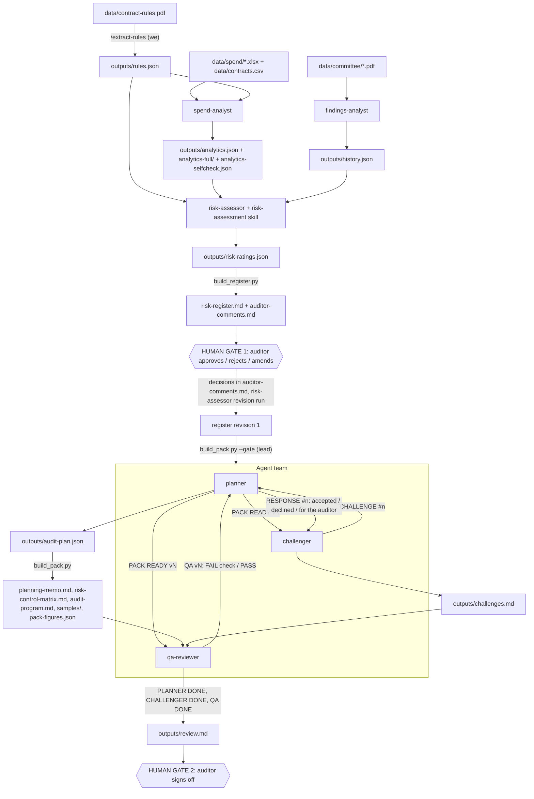

# Procurement Audit Planning Agent: West Berkshire Council

Team: Prarthana Patel, Shivathmika Ramanathan, Sai Subramanian, Bhavika Vidya Kempaiah, Nivesh Kannan Elangovanraaj — UCLA Anderson MSBA

Course submission. Everything below is read from files in this repository and its git log.

## 1. Overview

An agentic system that plans an internal audit of procurement for West Berkshire Council from its public data. It turns the Contract Procedure Rules into testable rules, analyses the full spend population against them, folds in past audit history, rates the risks, and produces a cross-checked audit planning pack for a human auditor to approve (`CLAUDE.md`).

**Problem it solves** (`CLAUDE.md`): planning a procurement audit is slow, manual and mostly reading-based. Auditors read a ~50-page rulebook and years of committee papers, then pick a small random sample without first analysing the full spend data. So it is slow, random sampling of 25 payments out of ~15,000 will almost certainly miss the handful of suspicious ones, two auditors give different ratings from the same material, and patterns such as split purchases, threshold-hugging and off-contract spend only show up when the whole population is analysed together.

**Design principles** (`CLAUDE.md`): the LLM reads and judges while Python computes every number; everything is traceable (verbatim quotes checked against the PDF, every metric reproducible from a script); agents inspect data through aggregates only; missing or malformed input means stop and report.

> **Outputs are risk indicators to investigate, not findings.** Nothing in this repository alleges wrongdoing by the council, a department or a supplier. Absence of a contract notice, for example, is only an indicator.

Data (all public, in `data/`): `contract-rules.pdf`, three monthly "Expenditure over £500" workbooks (`data/spend/Over500_2026_P02`, `P03`, `P04`), `contracts.csv` (Contracts Finder export), and four Governance Committee PDFs in `data/committee/`.

## 2. Skills (`.claude/skills/`)

| Skill | Purpose | Inputs | Outputs | Verifier / builder | Who runs it |
|---|---|---|---|---|---|
| `extract-rules` | Extract every testable rule from the Contract Procedure Rules, with clause, page, thresholds and a verbatim quote; list non-testable clauses in `excluded` and PDF contradictions or placeholders in `notes` | `data/contract-rules.pdf` (needs `pdftotext`) | `outputs/rules.json` | `verify_quotes.py` (schema, sequential IDs, null parameters, every quote present on its stated page, every PDF clause in `rules` or `excluded`); tests in `test_verify_quotes.py` with `fixtures/bad_rules.json` | **We**, by typing `/extract-rules`. No agent. |
| `risk-assessment` | The method for rating risks on the council's own likelihood × impact scale; the likelihood rubric is binding and the builder checks it | `outputs/rules.json`, `analytics.json`, `history.json` | `outputs/risk-ratings.json` (the agent's judgments), rendered by the builder into `risk-register.md` and the decision template `auditor-comments.md` | `build_register.py` resolves every citation and number and computes scores and bands; it also errors on any undecided risk when applying decisions; tests in `test_build_register.py` with `fixtures/` | **The `risk-assessor` agent** (loaded through its `skills:` field), launched by the main session at our request. It also does the revision run after our decisions. |
| `audit-program` | The method for turning approved risks into an audit program (risk → control → test step → targeted sample), a risk-control matrix, a planning memo and a PBC request list | `rules.json`, `analytics.json` and `analytics-full/`, `risk-ratings.json`, `risk-register.md`, `auditor-comments.md` | `outputs/audit-plan.json` (the planner's judgments), rendered by the builder into `planning-memo.md`, `risk-control-matrix.md`, `audit-program.md`, plus `samples/T-*.csv` and `pack-figures.json` | `build_pack.py`: `--gate` checks scope, then it resolves citations and figures, draws samples and renders documents; tests in `test_build_pack.py` with `fixtures/` | **The `planner` agent** runs `build_pack.py`. The main session (lead) runs `build_pack.py --gate` before spawning the team. |

## 3. Agents (`.claude/agents/`)

All six set `memory: project` (per-agent memory in `.claude/agent-memory/`, how-to lessons only, never evidence).

| Agent | Type | Tools | Inputs | Outputs | May not |
|---|---|---|---|---|---|
| `spend-analyst` | Sub-agent | Read, Write, Edit, Glob, Grep, Bash | `rules.json`, `data/spend/*.xlsx`, `data/contracts.csv` | `outputs/analytics.json`, `outputs/analytics-full/`, `outputs/analytics-selfcheck.json`; Python in `scripts/` | Do arithmetic itself; print whole tables; use wrongdoing language (fraud, suspicious, evasion…); hardcode a threshold; count a non-exact name match as a match; modify `data/`; continue on missing or malformed input |
| `findings-analyst` | Sub-agent | Read, Write, Edit, Glob, Grep, Bash | `data/committee/*.pdf` | `outputs/history.json` (via `scripts/build_history.py`, checked by `scripts/verify_history.py`) | Rate, rank, recommend or judge; add anything not in the papers (it goes in `gaps`); do arithmetic; copy personal data; modify `data/` |
| `risk-assessor` | Sub-agent (skill: `risk-assessment`) | Read, Write, Edit, Glob, Grep, Bash | `rules.json`, `analytics.json`, `analytics-full/`, `history.json` | `outputs/risk-ratings.json` only; the builder writes `risk-register.md` and `auditor-comments.md` | Edit inputs, the skill or the builder; hand-write the register or the decision file; approve scope or write "approved/in scope" as a decision; fill in `auditor-comments.md`; rate from memory |
| `planner` | Agent-team teammate (skill: `audit-program`) | Read, Write, Edit, Glob, Grep, Bash, SendMessage | Gate output, the inputs above, challenger and QA messages | `outputs/audit-plan.json` only; the builder writes memo, matrix, program, samples, `pack-figures.json` | Hand-write builder outputs or draw samples; edit inputs or the builder; add, drop, re-rate or move a risk in or out of scope; plan before the gate passes; name a supplier or allege wrongdoing |
| `challenger` | Agent-team teammate | Read, Write, Edit, Glob, Grep, Bash, SendMessage | Register, auditor decisions, ratings, analytics, history, rules, the planner's pack | `outputs/challenges.md` only | Edit the plan, pack, register or inputs; re-rate or change scope; read `data/` or `analytics-full/`; send a challenge without a citation and a specific ask; mark a row resolved on the planner's word. At most 8 challenges in round 1 and 4 in round 2 |
| `qa-reviewer` | Agent-team teammate | Read, Write, Bash, SendMessage | The finished pack, via `scripts/checks/run_checks.py` | `outputs/review.md` only | Fix or patch anything, skip or re-run checks to get a pass, soften a result, rate risks or judge scope, or edit the auditor's sign-off block |

Agent teams are enabled by `CLAUDE_CODE_EXPERIMENTAL_AGENT_TEAMS=1` in `.claude/settings.json`.

## 4. How they work together

**Team message protocol** (from `planner.md`, `challenger.md`, `qa-reviewer.md`):
- `PACK READY v<N>: <k> risks in scope, <t> tests, <s> sample files` is sent by the planner to challenger and qa-reviewer after every clean build. The other two wait for v1.
- `CHALLENGE #n` goes challenger → planner, with a citation and an ask. The planner answers `RESPONSE #n: accepted | declined | for the auditor`. A re-rating or scope change is always "for the auditor".
- `QA v<N>: FAIL <check>: <items>` or `QA v<N>: PASS` goes qa-reviewer → planner, on every pack version.
- `PLANNER DONE v<N>`, `CHALLENGER DONE` and `QA DONE v<N>: READY FOR SIGN-OFF | BLOCKED` go to the lead. `BLOCKED` sends the pack back to the team, never to the auditor.

## 5. Confirmation of guide steps

Guide: https://procurement-audit-planner.vercel.app/ (step titles as we supplied them). Commits are `git log` short hashes.

| Step | What | Proof |
|---|---|---|
| P1 | VS Code is installed | Not provable from the repo. |
| P2 | Claude Code is installed and signed in | Commits carry the `Co-Authored-By: Claude Sonnet 5.5` line; `.claude/` exists. |
| 1.1 | Make a folder, open it, start Claude Code | Git repo; first commit `15b74c3` (Setup). |
| 1.2 | Hand over the project brief | `CLAUDE.md`, added in `15b74c3`. |
| 1.3 | Download the data folder | `data/` in `15b74c3`: `contract-rules.pdf`, `contracts.csv`, 3 spend workbooks, 4 committee PDFs. |
| 1.4 | Set up Python and check the data | `requirements.txt` (pandas, openpyxl) and `.gitignore` (`.venv/`) in `15b74c3`; `.venv/` exists locally, uncommitted. The data check is evidenced by `analytics.json` `inputs` (3 workbooks, sheet "Data to publish", header rows found). |
| 1.5 | Create the project folders | `.claude/skills`, `.claude/agents`, `scripts/`, `outputs/` exist; git tracks them only through the files committed in `4d726f6` onwards. |
| 2.1 | Build the extract-rules skill | `4d726f6`: `.claude/skills/extract-rules/` (`SKILL.md`, `verify_quotes.py`, test, `fixtures/bad_rules.json`). |
| 2.2 | Run the skill | `4d726f6`: `outputs/rules.json`. |
| 3.1 | Build the spend-analyst | `9a1d945`: `.claude/agents/spend-analyst.md` (and `CLAUDE.md` updates). |
| 3.2 | Run the spend-analyst | `9ae0003`: `outputs/analytics.json`, `analytics-full/`, `analytics-selfcheck.json`, `scripts/`. |
| 3.3 | Build the findings-analyst | `b44f13d`: `.claude/agents/findings-analyst.md`. Build and run share one commit. |
| 3.4 | Run the findings-analyst and check it | `b44f13d`: `outputs/history.json`, `scripts/verify_history.py`; verifier PASS (below). |
| 3.5 | Build the risk-assessment skill | `f71c9bf`: `SKILL.md`, `build_register.py`, test, fixtures. |
| 3.6 | Build the risk-assessor | `8918c37`: `.claude/agents/risk-assessor.md`. |
| 3.7 | Run the risk-assessor, review the register | `aa9a59b`: `risk-ratings.json`, `risk-register.md`, `auditor-comments.md`. |
| 4.1 | Open the decision template | `aa9a59b`: `outputs/auditor-comments.md` template. |
| 4.2 | Record your decisions | `514e2a3`: Decision and Comment cells in `auditor-comments.md`. |
| 4.3 | Revise the register | `514e2a3`: `risk-register.md` is "REVISION 1"; `risk-ratings.json` updated. |
| 5.1 | Close the gate | Satisfied by 4.3. `build_pack.py --gate` requires every risk decided and the register to be a revision. It passed before the team was spawned: `GATE PASS: register revision 1; in scope R-01, R-02, R-03, R-05 (3 approved, 1 amended); rejected R-04`. That run left no file of its own. |
| 5.2 | Enable agent teams | `d4fa1be`: `.claude/settings.json` sets `CLAUDE_CODE_EXPERIMENTAL_AGENT_TEAMS=1`. |
| 5.3 | Build the audit-program skill | `d4fa1be`: `.claude/skills/audit-program/` (`SKILL.md`, `build_pack.py`, test, fixtures). |
| 5.4 | Build the planner | `d4fa1be`: `.claude/agents/planner.md`. |
| 5.5 | Build the challenger | `d4fa1be`: `.claude/agents/challenger.md`. |
| 5.6 | Build the qa-reviewer and its checks | `d4fa1be`: `.claude/agents/qa-reviewer.md`, `scripts/checks/` (`run_checks.py`, four checks, `common.py`, `test_checks.py`). |
| 5.7 | Run the team | `02a7a43`: `audit-plan.json`, three documents, `samples/`, `pack-figures.json`, `challenges.md`, `review.md`, planner memory. |
| 5.8 | Sign off | `02a7a43`: sign-off block in `outputs/review.md`. |

### Key results (read from the files)

| Area | Result |
|---|---|
| Rules (`rules.json`) | 74 rules, 43 excluded clauses, 15 notes, 160 PDF clauses covered. Types: exception 16, record-keeping 14, procedure 12, approval 12, contract-terms 8, advertising 7, valuation 2, formality 2, anti-avoidance 1. All four Threshold parameters are `null`. |
| Rules verifier (`verify_quotes.py`) | `PASS: 74 rules, 43 excluded, 15 notes, 160 PDF clauses; 0 error(s), 2 warning(s)`. The warnings: `THRESHOLD_WORKS_CONCESSION` and `THRESHOLD_LIGHT_TOUCH` are declared but no rule bound uses them. |
| Spend analytics | Window 2026-05-01 to 2026-07-31. 10,607 rows read, 8,476 analysed (£65,987,980.13, 1,074 suppliers). Excluded: redacted_supplier 2,015, public_body 47, personal_transfer 46, pension_statutory 23. Contracts: 150 rows read, 141 kept. |
| Tests run (count: all tags / general_procurement) | threshold_clustering 408 / 47; split_purchases 613 / 132; off_contract 628 / 150; duplicates 646 / 49; expired_notice_spend 7 / 5; spend_vs_award 7 / 6; high_value_suppliers 667 / 183. The risks (R-01 to R-03) cite the general_procurement figures, not the all-tags counts. |
| Analytics self-check | `status: passed`; all 7 tests re-derived from the raw workbooks with result `pass`. |
| History (`history.json`) | 4 documents, 16 audit opinions, 4 follow-ups, 20 risk themes, 8 scoring-method items, 13 discrepancies, 8 gaps, 0 agreed actions. `verify_history.py`: `quotes checked: 159`, `PASS`. |
| Register (revision 1) | R-01 L2 × I4 = 8 High; R-02 L3 × I3 = 9 High; R-03 L3 × I3 = 9 High; R-05 L3 × I4 = 12 High (likelihood 2 → 3, auditor override); R-04 removed on rejection. Scoring uses the council's Risk Management Strategy 2024-27. |
| Our decisions (`auditor-comments.md`) | R-01, R-02, R-03 Approve; R-04 Reject (duplicate payments are an accounts-payable matter, to be covered in a separate AP review); R-05 Amend L=3. |
| Pack | v3 (final). 4 risks, 10 tests, 10 sample files with 359 rows (285 distinct transactions), 49 of 74 rules cited, 25 listed as not tested. |
| Challenges | 8 in two rounds (7, then 1). Resolved 5 (#1, #4, #5, #6, #8); declined 0; for the auditor 3 (#2, #3, #7). |
| QA (`review.md`, final run on v3) | check_quotes PASS; check_numbers PASS (19 figures); check_trace PASS; check_samples PASS (285 distinct transactions). `VERDICT: ALL CHECKS PASS`, so READY FOR SIGN-OFF. History: v1 PASS (interim), v2 PASS (interim), v3 PASS (final). |
| Our sign-off | Prarthana Patel, 2026-10-16, **signed off** (box ticked in `review.md`), with comments on #2, #3 and #7. |

## 6. Design decisions and deviations from the guide

- **Case-insensitive council filter.** `CLAUDE.md` says to keep `contracts.csv` rows where Organisation Name, trimmed and compared case-insensitively, is "West Berkshire Council" or "West Berkshire", so "WEST BERKSHIRE COUNCIL" is kept. `scripts/notices.py` implements it with `.str.strip().str.lower()`, and the run kept 141 of 150 rows. The rule is already in the `CLAUDE.md` of the first commit, so git has no separate commit for the change.
- **`general_procurement` reported separately from care placements.** Every test is split by tag in `analytics.json`. R-01 to R-03 cite the `general_procurement` metrics. Care and education placements get their own risk, R-05, and the planner tests them in their own test, never mixed into a general procurement sample.
- **£1,000 tier left out.** `analytics.json` records that the £1,000 bound (CPR-58) has `evidence_source` of document-request only, so it is not a tier. The lowest tier analysed is £5,000.
- **5.1 satisfied in 4.3.** The register builder refuses to apply decisions while any risk is undecided, and `build_pack.py --gate` fails on an undecided risk or a revision-0 register. A partial revision cannot exist, so closing the gate was done by completing the revision in 4.3 and then confirming it with `--gate`.
- **`--interim` QA flag.** `run_checks.py --interim` skips the `challenges.md` closure test inside `check_trace`, so the qa-reviewer could check v1 and v2 while challenges were still open. The final run on v3 was made without it.
- **Challenger caught an error in our R-05 amend comment.** Challenge #3 said OP-12 (Personal Budgets, Limited Assurance) sits in Children with Disabilities and SEN, not adult social care as our comment said. We corrected it in the sign-off comment in `review.md`: the amend to L3 stands because SEN overlaps the education-placement side of R-05. The original wording is still in `auditor-comments.md`, `risk-register.md` and `planning-memo.md`, because those were written before sign-off.
- **Open handling note.** `CHALLENGER DONE` first recorded #8 as declined against v2, crossing the planner's acceptance. The challenger verified v3 and corrected `challenges.md` to resolved.

## 7. How to reproduce

**Prerequisites**
- Claude Code, with `CLAUDE_CODE_EXPERIMENTAL_AGENT_TEAMS=1` (set in `.claude/settings.json`).
- Python venv at `.venv/` with `pip install -r requirements.txt` (pandas, openpyxl).
- poppler (`pdftotext`, `pdfinfo`) on PATH, which the quote verifiers use.
- The `data/` inputs listed in section 1.

**Order** (from the project root, in Claude Code)
1. `/extract-rules`, then `.venv/bin/python .claude/skills/extract-rules/verify_quotes.py` → `outputs/rules.json`.
2. Run `spend-analyst` → `analytics.json`, `analytics-full/`, `analytics-selfcheck.json`.
3. Run `findings-analyst` → `history.json`; check with `.venv/bin/python scripts/verify_history.py`.
4. Run `risk-assessor` → `risk-ratings.json`, `risk-register.md`, `auditor-comments.md`.
5. **Gate 1:** fill in Decision and Comment for every risk in `outputs/auditor-comments.md`, then run `risk-assessor` again for the revision run.
6. `.venv/bin/python .claude/skills/audit-program/build_pack.py --gate` must print `GATE PASS`.
7. Spawn `planner`, `challenger` and `qa-reviewer` as teammates; they coordinate by the messages in section 4 until all three report done.
8. **Gate 2:** complete the sign-off block at the end of `outputs/review.md`.

Unit tests: `test_verify_quotes.py`, `test_build_register.py`, `test_build_pack.py`, `scripts/checks/test_checks.py` and `scripts/test_verify_history.py`. Re-run the QA checks any time with `.venv/bin/python scripts/checks/run_checks.py`.

## 8. Part B: Deployed agent harness

**Live at https://procurement-audit-harness-prarthana.fly.dev/** (source in `harness/`, plus `Dockerfile`, `fly.toml` and `.dockerignore` at the repo root).

### Architecture

- **App:** FastAPI (`harness/app.py`) serving one HTML page (`harness/static/index.html`, no build step) and a JSON API. Runs execute as background tasks, and the page polls their progress.
- **Engine** (`harness/engine.py`): Python with the Claude Agent SDK (`claude-agent-sdk`), loading this repo's own `CLAUDE.md`, `.claude/agents` and `.claude/skills` as project settings. We did not rewrite any skill or agent. The model is a Sonnet alias (`HARNESS_MODEL`, default `sonnet`), with a per-session budget cap (`HARNESS_MAX_BUDGET_USD`, default 5). It authenticates with the `ANTHROPIC_API_KEY` environment variable, which is never logged or returned: progress text is redacted before it is stored.
- **Fly.io** (`fly.toml`): app `procurement-audit-harness-prarthana` in `lax`, one `shared-cpu-1x` machine with 2GB RAM, a 1GB volume `data` mounted at `/data`, internal port 8080, `auto_stop_machines = "off"` and `min_machines_running = 1` so long runs are not stopped, and an HTTP health check on `/healthz` every 15 seconds. `ANTHROPIC_API_KEY` and `RUN_ACCESS_CODE` are Fly secrets.
- **Image** (`Dockerfile`): Python 3.12 slim with `poppler-utils` for the quote verifiers, our requirements, and no Node, because the SDK bundles the Claude Code CLI. The app runs as an unprivileged user (`harness/entrypoint.sh` fixes ownership of `/data`, then drops root), because Claude Code refuses `bypassPermissions` as root.
- **Per-run repo copies:** every run works in `/data/runs/<id>`, a copy of the repo in which every committed file is kept and only `outputs/` starts empty, so the committed Part A outputs are never overwritten. In the copy, `.venv/bin/python` is a wrapper that runs the container's Python (the agent files call that path) and `.claude/settings.json` is `{}` (a run relays the team itself rather than enabling native agent teams). One run is active at a time. Before any API spend, a preflight checks that the five pipeline scripts, every other repo file, pandas, openpyxl, `pdftotext` and `pdfinfo` are present.

### Views

1. **Completed run:** renders our committed Part A outputs (risk register, auditor decisions, planning memo, risk-control matrix, audit program, challenges, review with sign-off). It makes no API calls and needs no access code.
2. **New run:** runs `/extract-rules`, then the spend-analyst and findings-analyst as two concurrent sessions, then the risk-assessor, streaming progress to the page. Each agent runs as its own SDK session built from its `.claude/agents/<name>.md` file (same system prompt, same tools), and the engine waits for each to finish before checking its outputs.

### Human gates in the browser

- **Gate 1:** the page shows the register and one row per risk: Approve, Amend (with likelihood and/or impact 1 to 5) or Reject, plus a comment and the reviewer's name. Every risk needs a decision, and Amend and Reject need a comment. On submit the harness writes `auditor-comments.md` in the same format as Part A (`Reviewer: <name>, <date>. L=3. <comment>`), runs the risk-assessor revision, and confirms the gate check (`build_pack.py --gate`) passes. We then start the agent team with a separate button.
- **Gate 2:** the page shows the QA verdict, the check results and every document, with a sign-off form (auditor name, "signed off" or "returned", comment). The harness writes the sign-off block at the end of `review.md`. It refuses "signed off" unless the verdict is READY FOR SIGN-OFF, and refuses "returned" without a reason.

### Agent team: relay orchestrator

The SDK has no team API, and we did not try native agent teams, because that needs paid calls. `run_team` in `harness/engine.py` is therefore a relay orchestrator: one SDK session each for planner, challenger and qa-reviewer, built from the same agent files with the same tools minus `SendMessage`, and with the `audit-program` skill for the planner. Agents write `SEND TO <name>:` lines, and the orchestrator delivers them as the next turn of the recipient's session. The protocol is unchanged: `PACK READY vN`, `CHALLENGE #n`, `RESPONSE #n`, `QA vN: PASS | FAIL`, then `PLANNER DONE`, `CHALLENGER DONE` and `QA DONE`. A new `PACK READY` clears earlier DONE messages, and the relay only finishes when all three DONE messages have arrived. If the team goes quiet it sends status checks and fails after three unanswered ones. Every session has a hook that refuses sub-agent launches and background commands, so no turn ends while work is still running.

### Access code

Starting a run, submitting either gate, starting the team and abandoning a run all require the access code (header `X-Access-Code`, checked against the `RUN_ACCESS_CODE` secret). A wrong or missing code gets 403 and creates nothing. If `RUN_ACCESS_CODE` is not set on the server, runs are disabled (503). Starting also needs `ANTHROPIC_API_KEY` to be set.

### Bugs found and fixed during the first live runs

| Bug | What happened | Fix |
|---|---|---|
| Dockerfile requirements overwrite | The first deploy failed: both `COPY` sources landed as `./requirements.txt`, so `pip` could not open `harness/requirements.txt`. | `bed7c6b`: the two files are copied under separate names. |
| Background sub-agents not awaited | In the first live run, the lead launched the spend-analyst and findings-analyst in the background and ended its turn. Six seconds later the engine raised "expected output missing: analytics.json, analytics-selfcheck.json, history.json". | `6cca422`: each analyst, and the risk-assessor for both the build and the revision, runs as its own awaited SDK session, the two analysts concurrently. A hook refuses background work, and a preflight was added. A test with a fake session that finishes late proves the engine waits. |
| Committed scripts missing from run copies | In the second live run, `verify_history.py` exited 2 with "No such file or directory". The image was complete; our run-copy code deleted everything in `scripts/` except `checks/`. | `232cfb6`: every committed file is kept and only `outputs/` starts empty. The preflight now fails fast if a pipeline script or any repo file is missing, and we probed a fresh run copy inside the live container. |

### One full live run

Run `20261017-075222-4d89` went through every stage on the deployed harness. It reached **READY FOR SIGN-OFF** with **all 4 QA checks passing** (pack v2, 8 sample files, 312 distinct sampled transactions), was **signed off** by Prarthana Patel in the browser on 2026-10-17, and cost **$2.28** in API calls. It is a fresh regeneration from the model, not a copy of Part A, so its figures differ from the Part A results in section 5 (for example 68 rules extracted rather than 74).

### Tests and deploy

- Tests that make no API calls (the page, access code, gates, run copies, relay logic, waiting for slow sessions, preflight): `.venv/bin/python -m unittest discover -s harness/tests -t .`
- Deploy: `fly deploy --app procurement-audit-harness-prarthana --remote-only` (secrets are set in the Fly dashboard). More detail is in `harness/README.md`.
